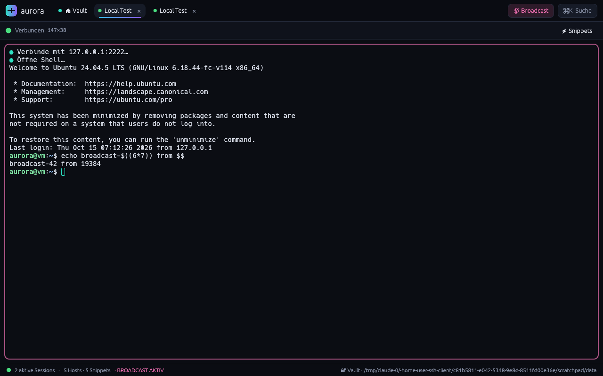
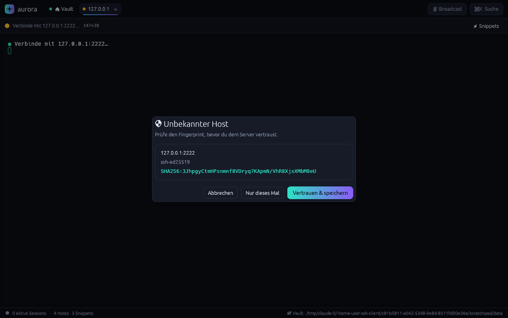

# ✦ Aurora

Ein moderner SSH-Client in **Rust** – inspiriert von Termius, aber mit eigenem Look:
tiefes Nacht-Blau mit Teal→Violett-„Polarlicht"-Akzenten, Befehlspalette, Broadcast-Modus
und ein verschlüsselter Vault für alle Zugangsdaten.


## Features

| Bereich | Was drin ist |
|---|---|
| **SSH** | Eingebauter Terminal-Emulator (xterm-256color, Truecolor, Scrollback, Maus-Auswahl, Bracketed Paste, Resize), Auth per Key / Passwort / Keyboard-Interactive, Keepalive, Reconnect per Enter |
| **SFTP** | Zwei-Pane-Browser lokal ⇄ remote, rekursiver Up-/Download mit Fortschritt, Drag & Drop aus dem Dateimanager, Ordner anlegen / umbenennen / löschen |
| **RDP** | Startet den nativen Client mit generiertem Profil: `mstsc` (Windows, Credentials via `cmdkey`), Windows App (macOS), FreeRDP 2/3 oder Remmina (Linux). Passwort geht per stdin, nicht über die Kommandozeile |
| **Serial** | Port-Erkennung, Baudrate, Datenbits, Parität, Stopbits, Flusskontrolle, Zeilenende (CR/LF/CRLF), lokales Echo |
| **Keychain** | Identitäten (User + Passwort und/oder Private Key), Ed25519-Key-Generator, Public-Key-Export, Fingerprint-Anzeige. Alles verschlüsselt mit **Argon2id + XChaCha20-Poly1305** |
| **Snippets** | Snippet-Bibliothek mit `{{variablen}}`-Platzhaltern (werden beim Ausführen abgefragt, mit Live-Vorschau), Tags, Snippet-Leiste direkt im Terminal, „in allen Sessions ausführen", Startup-Snippet pro Host |
| **Gruppen** | Verschachtelte Gruppen mit Farbe & Icon, Standard-User und Standard-Identität werden an Hosts vererbt, Favoriten, „Zuletzt verbunden", Tags, Suche (`group:Name`) |
| **Extras** | ⌘K/Ctrl+K-Befehlspalette (Fuzzy-Suche über Hosts, Snippets, Aktionen, `user@host` für Quick Connect), Broadcast-Modus (Eingabe an alle Terminals), Known-Hosts mit MITM-Warnung, Akzentfarbe wählbar |

## Screenshots

| | |
|---|---|
|  |  |
|  |  |
|  |  |

## Bauen & Starten

Voraussetzung: Rust ≥ 1.88 (Edition 2024).

```bash
cargo run --release
```

Unter Linux werden zur Laufzeit X11/Wayland-Bibliotheken benötigt (z. B. `libxkbcommon-x11-0`, `libgl1`).
Für RDP muss `xfreerdp3`/`xfreerdp` oder `remmina` installiert sein.

```bash
cargo test     # Unit-Tests (Vault-Krypto, Snippet-Variablen, Key-Mapping, Quick-Connect-Parser, …)
```

## Tastenkürzel

| Kürzel | Aktion |
|---|---|
| `Ctrl/⌘ + K` | Befehlspalette |
| `Ctrl + Tab` | Nächster Tab |
| `Ctrl/⌘ + Shift + W` | Tab schließen |
| `Ctrl + Shift + C` / Auswahl | Kopieren (Kopieren-bei-Auswahl ist einstellbar) |
| `Ctrl + V` / `Ctrl + Shift + V` | Einfügen |
| `Enter` in getrennter Session | Neu verbinden |

## Daten & Sicherheit

* `library.json` – Hosts, Gruppen, Snippets, Einstellungen, Known Hosts (keine Geheimnisse)
* `vault.json` – Keychain, verschlüsselt (Argon2id m=64 MiB, t=3 → XChaCha20-Poly1305, neue Nonce pro Speichern)

Speicherort: das plattformübliche Datenverzeichnis (`~/.local/share/AuroraTerm`, `%APPDATA%\Aurora\AuroraTerm`,
`~/Library/Application Support/dev.Aurora.AuroraTerm`) oder `AURORA_DATA_DIR`.

Server-Keys werden beim ersten Verbinden per SHA256-Fingerprint bestätigt (Trust on First Use).
Ändert sich ein Key, zeigt Aurora eine deutliche Warnung mit altem und neuem Fingerprint.

## Architektur

```
src/
├── main.rs            Fenster-Setup (eframe/egui)
├── app.rs             App-Zustand, Tabs, Session-Lifecycle, Layout
├── terminal.rs        vt100-Parser + Renderer + Tastatur→Escape-Sequenzen
├── theme.rs           Aurora-Theme, Gradients, Chips, Avatare, Logo
├── model.rs           Hosts, Gruppen, Snippets, Identitäten (serde)
├── store.rs           Persistenz + verschlüsselter Vault
├── keygen.rs          Ed25519-Erzeugung, Public-Key/Fingerprint
├── backend/
│   ├── ssh.rs         russh: Verbindung, Auth, Host-Key-Prüfung, Shell
│   ├── sftp.rs        russh-sftp: Listing, rekursive Transfers
│   ├── serial.rs      serialport auf eigenem Thread
│   └── rdp.rs         Start des nativen RDP-Clients
└── ui/                Views (Hosts, Keychain, Snippets, SFTP, Einstellungen),
                       Editoren, Dialoge, Befehlspalette, Lock-Screen
```

Netzwerk läuft auf einer tokio-Runtime; jede Session kommuniziert mit der UI nur über Channels
und weckt sie per `request_repaint`, sodass die App im Leerlauf keine CPU verbraucht.
