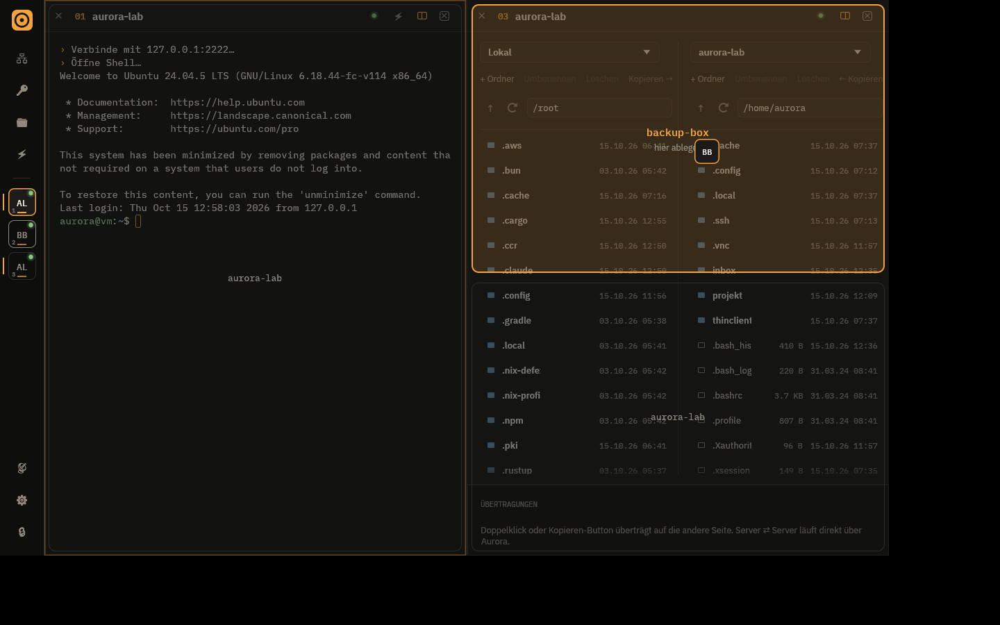

# Aurora

A modern client for **SSH, SFTP, RDP, VNC, Telnet, serial consoles and Docker/Kubernetes
containers**, written in Rust: clean, fast, with an encrypted keychain, snippets, host groups,
tunnels, a live log viewer and switchable themes. UI in English and German.


## Download

Every [release](../../releases) contains Windows, Linux and macOS:

| System | File | Install |
|---|---|---|
| **Windows** (x64) | `Aurora-<version>-windows-x64-setup.exe` | run the installer |
| | `Aurora-<version>-windows-x64-portable.zip` | unzip, start `Aurora.exe` |
| **Linux** (x86_64) | `aurora_<version>_amd64.deb` | `sudo apt install ./aurora_<version>_amd64.deb` |
| | `aurora-<version>-linux-x86_64.tar.gz` | unpack, `./install.sh` or `./aurora` |
| **macOS** 11+ (Apple Silicon & Intel) | `Aurora-<version>-macos-universal.dmg` | open, drag Aurora to Applications |

The macOS app is not notarized: on first start right-click Aurora → *Open*
(or `xattr -cr /Applications/Aurora.app`). Language: *Settings → Sprache / Language*.

## Features

| Area | |
|---|---|
| **SSH** | Own terminal emulator (256 colours/truecolor, scrollback, selection, bracketed paste, resize), key/password/keyboard-interactive auth, keepalive, reconnect with Enter |
| **Files (SFTP)** | Own section in the rail. Two columns, each side **local or any server** – including **server ⇄ server** (streamed through Aurora, the servers don't need to reach each other). Windows servers with OpenSSH (`C:\path` is translated, local drive list), RDP hosts get their SFTP port. Recursive transfers with progress, drag & drop |
| **Edit remote files** | Double-click a server file to open it in your editor; every save is uploaded automatically (executable file types are never opened with the default app) |
| **Split screen** | Up to **4 sessions side by side** (terminal, files, RDP mixed) – drag a port from the rail into the window (a preview shows where it lands), ◫ menu or right-click. Double-click a header to maximize, "type into all panes", × ends a session, ↗ only detaches it |
| **Tunnels & jump host** | Port forwardings per host as switches in the list (status LED, optionally open the browser); "connect via" another SSH host (ProxyJump) – used for terminal, files and tunnels |
| **RDP** | Inside the tab (IronRDP): follows the window size, **clipboard in both directions** (automatic + "copy from host"/"send to host" buttons), **Ctrl+Alt+Del**, Windows key, type the clipboard as keystrokes (for login screens/consoles). Optionally in the system client (mstsc, FreeRDP, Remmina) |
| **VNC** | Inside the tab (own RFB client: ZRLE, CopyRect, Raw, resize, VNC password): fit or 1:1, Ctrl+Alt+Del, clipboard in both directions, type the clipboard as keystrokes, view-only mode |
| **Telnet** | For switches, routers and old devices: option negotiation (echo, window size, terminal type) and optional auto-login with the stored user and password |
| **Serial** | Port detection, baud rate, format, flow control, line ending, local echo |
| **Docker & Kubernetes** | Containers and pods as their own session type – on this PC or on any SSH host. "Browse containers" lists `docker ps` / `kubectl get pods` (Podman and kube contexts supported); one click opens a shell (bash, else sh) or the logs, or saves the container to the host list |
| **Log viewer** | Follow a file (`tail -F`), `journalctl -f` or container logs live in their own tab: filter (`nginx \| timeout`), only matches or highlighting, errors/warnings colored and filterable, pause with a counter of waiting lines, copy, wrap. From the host menu ("View log…") or right-click a file in the file browser ("Follow as log") |
| **Terminal profile** | Per host: own color theme (e.g. PROD always in a different look), font and font size. Fonts: IBM Plex Mono, Hack, installed monospace fonts (Cascadia, Consolas, Menlo, DejaVu, JetBrains Mono …) or any .ttf/.otf file |
| **Host list** | After the first login it shows **OS, uptime, disk usage and pending updates** (one click: "install updates"), latency and status (green = reachable, ring = no answer, red = last connection failed). Hosts without a name take the server's hostname, rename with `F2`. Multi-select (Ctrl/Shift+click) with bulk actions, drag hosts into groups, compact view, sorting. Groups show "x/y online"; hosts in the same subnet can be grouped with one click |
| **Network scan** | Finds SSH/RDP devices in the local network (with an OS hint from the SSH banner) and adds them |
| **SSH key setup** | Generates a key, installs it on the server, verifies the login – no more passwords |
| **Keychain** | Passwords & SSH keys, Ed25519 generator, encrypted with Argon2id + XChaCha20-Poly1305 |
| **Snippets** | `{{variable}}` placeholders with live preview, snippet panel in the terminal, run in all sessions, startup snippet per host, save selected terminal text as a snippet |
| **Groups** | Nested, colour & icon, inherited default user/identity, favourites, recently used, tags |
| **Productivity** | **Quick connect**: `user@host`, `host:port` or `ssh -p 2222 user@host` in `Ctrl+K`, then "save as host" · **open a whole group** side by side · **search in the terminal** (`Ctrl+Shift+F`, incl. scrollback) · **font size with `Ctrl` + mouse wheel** per pane · import from `~/.ssh/config` · sessions and split layout are **restored on the next start** |
| **Safety** | **Environment labels** PROD / STAGING / TEST / DEV per host or group – PROD sessions get a red frame and **ask before dangerous commands** (`rm -rf`, `reboot`, `DROP TABLE` …) · **notes per host** shown when connecting · **auto-lock** after inactivity (sessions keep running) · clear error messages with the next step |
| **Comfort** | Reachability LED per host (TCP check with latency), **update check** on start with one-click update (SHA256-verified) · drop files onto a terminal to upload them to the current directory · a port blinks when a long command finishes in the background · disconnected sessions marked with ⟳, click to reconnect · encrypted **export/import** of hosts, groups, snippets and keys |
| **Design** | Own "Patchbay" design: sessions as numbered ports with status LEDs, IBM Plex Sans/Mono. 12 themes (Phosphor, Glacier, Nord, Dracula, Paper, Tokyo Night, Gruvbox, Catppuccin, Rosé Pine, Solarized Dark/Light, GitHub Light) – the terminal follows the theme. Command palette `Ctrl/⌘+K`, broadcast mode, first-start tour, shortcut overview with `F1` / `?` |

| | |
|---|---|
|  |  |
|  |  |
|  |  |
|  |  |
|  |  |
|  |  |
|  |  |

(Screenshots show the German UI.)

## Keyboard shortcuts

| Shortcut | Action |
|---|---|
| `Ctrl/⌘ + K` | Command palette (hosts, snippets, tunnels, themes, `user@host`) |
| `Ctrl + 1…9` | Jump to port/session 1…9, `Ctrl + 0` back to the overview |
| `Ctrl + Tab` | Next session |
| `Ctrl/⌘ + Shift + W` | Close session |
| `Ctrl + Shift + F` | Search in the terminal (Enter = older, Shift+Enter = newer match) |
| `Ctrl` + mouse wheel | Terminal font size |
| `F1` / `?` | All shortcuts |
| `Ctrl + Shift + C` / selection | Copy in the terminal |
| `Enter` in a disconnected session | Reconnect |

## Building

Rust ≥ 1.88:

```bash
cargo build --release                                              # app
cargo build --release --manifest-path crates/aurora-rdp/Cargo.toml # RDP component
cargo test
```

The RDP component is a separate crate (`crates/aurora-rdp`) because IronRDP pins crypto
pre-releases that clash with russh. It runs as a helper process next to `aurora` and streams only
changed screen regions. Two small fixes to IronRDP live in `crates/aurora-rdp/vendor`
(marked `AURORA PATCH`).

Releases: start the "Release" workflow under *Actions* (version input) or push a tag `v<version>` –
GitHub Actions builds Windows, Linux and macOS and publishes everything in one release including
`SHA256SUMS.txt` (used by the in-app updater). Windows builds are code-signed when the repository
secrets `WINDOWS_CERT_PFX` (base64 .pfx) and `WINDOWS_CERT_PASSWORD` are set.

Translations: German is the source language; English texts live in `src/i18n/*.rs`
(`t!("…")` in the code). A test fails if a text has no translation.

## Data & security

* `library.json` – hosts, groups, snippets, settings, trusted servers (no secrets)
* `vault.json` – keychain, encrypted
* Location: `~/.local/share/AuroraTerm`, `%APPDATA%\Aurora\AuroraTerm\data`,
  `~/Library/Application Support/dev.Aurora.AuroraTerm` or `AURORA_DATA_DIR`

Server keys (SSH) and TLS certificates (RDP) are confirmed and pinned on first connect.
Details and review results: [SECURITY.md](SECURITY.md).

## Architecture

```
src/
├── app.rs             state, tabs, session lifecycle, layout
├── terminal.rs        vt100 + renderer + keyboard → escape sequences, search, zoom
├── theme.rs           "Patchbay" design system: palettes, fonts, widgets
├── update.rs          update check (GitHub releases) and self-update
├── i18n/              English texts for the German source strings
├── model.rs / store.rs  data, persistence, vault, export
├── backend/           ssh (incl. jump host), sftp (incl. server⇄server), tunnel, scan, serial, rdp, reach,
│                      vnc (RFB client), telnet, local (pseudo terminal), container, logs
└── ui/                rail (chrome), hosts, keychain, snippets, files, RDP, VNC, log viewer, containers,
                       settings, dialogs, palette
assets/fonts/          IBM Plex Sans/Mono (SIL OFL)
crates/aurora-rdp/     IronRDP helper process (stdio protocol)
packaging/             .deb/.tar.gz script, Inno Setup installer, macOS .app/.dmg script
```
